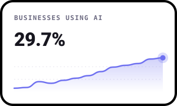
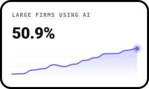
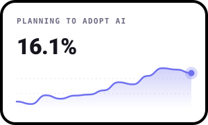
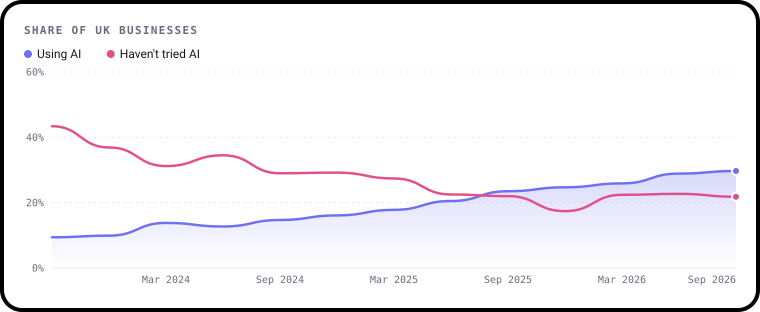
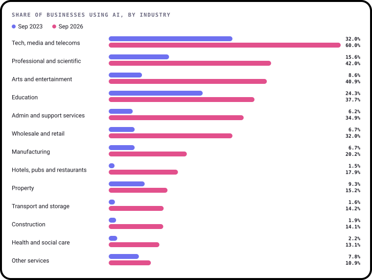
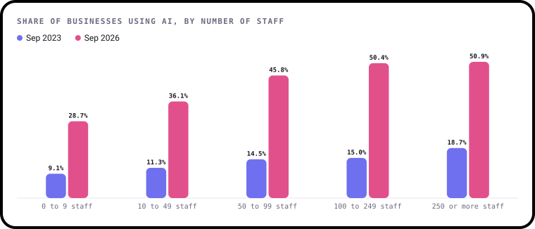
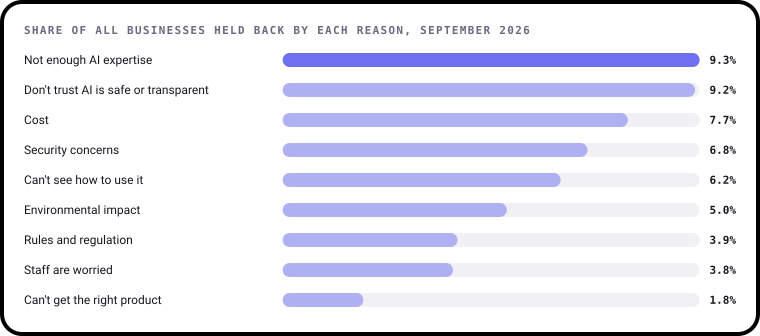
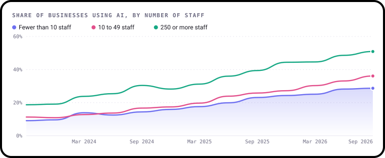

# AI & the Economy

**A free, friendly UK data challenge about artificial intelligence at work: who's using it, who isn't, and what's holding businesses back.**

Three years ago, fewer than one UK business in ten used any kind of AI. Now it's close to one in three. That's one
of the fastest changes in how businesses work in a generation, and it's uneven: some industries have gone all in,
others have barely started, and the biggest firms are pulling ahead of the smallest. Behind the headlines are
real questions about skills, trust, cost and jobs.

This project does two things:

1. **It answers questions.** The [State of AI in UK business](findings/README.md) report has five findings, each with
   a chart and a plain-English explanation. It redraws itself every time the ONS publishes new figures.
2. **It asks you questions.** Each month there's a new challenge. Dig into the data, make something and share it.
   No sign-up and no gatekeeping. Beginners are very welcome.

> 📈 **Every chart here is drawn with [bezel-charts](https://pypi.org/project/bezel-charts/), an open-source Python
> library created by Shaz Moghaddam, the author of this project.** It turns pandas data into clean, self-contained
> SVG charts in one line. `pip install bezel-charts` · [PyPI](https://pypi.org/project/bezel-charts/) ·
> [GitHub](https://github.com/ShazMoghaddam/bezel-charts)

---

## Right now

<!-- tiles:start -->
<p align="center">
  
  
  
</p>
<!-- tiles:end -->

*The latest figures, with every survey since 2023 behind them. Updated automatically from the ONS.*

---

## Key findings

<!-- key-findings:start -->
### 3 times as many businesses use AI as in 2023

**29.7%** of UK businesses used AI in September 2026, up from 9.4% in September 2023. Since September 2025, more businesses use AI than say they haven't tried it.
Most of it is light use of everyday tools like ChatGPT.



### It depends what you do

**60.0%** of tech, media and telecoms businesses use AI, against **10.9%**
in other services.



### Big firms are pulling ahead

**50.9%** of firms with 250 or more staff use AI, against 28.7% of those with fewer than 10. The gap has grown to 22.2 points.



### Skills and trust are now the biggest barriers

Firms that haven't tried AI fell from 43.4% to 21.8%. Now the biggest things holding
businesses back are **not enough AI expertise** and **don't trust AI is safe or transparent**.


<!-- key-findings:end -->

**[Read all five findings in the State of AI in UK business report →](findings/README.md)**

| # | Finding | |
|---|---|---|
| 1 | How fast is AI spreading? | Three years of growth, and the businesses that still haven't tried it |
| 2 | Which industries are using it? | From tech firms to care homes, then and now |
| 3 | Big firms against small firms | Is the size gap closing or growing? It depends how you measure it |
| 4 | Where in the UK? | AI use by nation and region, and why place matters less than you'd think |
| 5 | What's holding businesses back? | How the barriers have moved from "is this for us?" to "can we trust it?" |
| + | What about jobs? | What AI has done to headcount at the businesses using it |

---

## This month

### January 2027: The small-business gap

**The question:** Why are the smallest businesses so much less likely to use AI than the biggest, and is the gap
closing?

Most UK businesses have fewer than 10 staff, so they decide the national picture. They've tripled their AI use
since 2023, but the biggest firms have grown faster in points, and the gap between them is wider than ever.



**Runs:** 1 to 31 January 2027
**Full brief:** [challenges/2027-01-the-small-business-gap](challenges/2027-01-the-small-business-gap/README.md)

| Level | What you'll do |
|---|---|
| 🟢 Beginner | Chart AI use for one size of business and spot when it grew fastest |
| 🟡 Intermediate | Compare the sizes. Is the gap closing in proportion, in points, or both? |
| 🔴 Expert | Bring in barriers or industry data and test an idea about why the gap exists |

---

## How it works

1. **Read the brief** for this month in the [`challenges`](challenges/) folder.
2. **Get the data.** It's already in this repo in the [`data`](data/) folder, starting with
   [`data/ai_use.csv`](data/ai_use.csv). Run `python data/fetch.py` to download the very latest straight from the ONS.
3. **Make something.** Python, R, Excel, Tableau, pen and paper scanned in: anything goes.
4. **Share it.** Fork this repo, add a folder at `submissions/2027-01/your-github-username/` with a short
   `README.md` (use the [template](SUBMISSION_TEMPLATE.md)), then open a pull request.

New to GitHub? [CONTRIBUTING.md](CONTRIBUTING.md) walks you through it step by step.

### Run it yourself

```bash
git clone https://github.com/ShazMoghaddam/uk-ai-economy.git
cd uk-ai-economy
pip3 install -r requirements.txt
python3 data/fetch.py        # download the latest figures from the ONS
python3 findings/build.py    # redraw every chart and rewrite the report
```

Every chart is drawn with [bezel-charts](https://pypi.org/project/bezel-charts/), a small open-source Python
library by the same author, Shaz Moghaddam. It also comes as web components for websites:
[github.com/ShazMoghaddam/bezel-charts](https://github.com/ShazMoghaddam/bezel-charts).

---

## The data

Everything comes from the ONS **Business Insights and Conditions Survey (BICS)**, which asks thousands of UK
businesses about how they're doing every two weeks. About once a quarter it adds questions on AI. Each file has
one row per survey wave and group, where a group is all businesses, one industry or one size band.

| File | What's in it |
|---|---|
| [`ai_use.csv`](data/ai_use.csv) | Which AI technologies businesses use, plus `using_ai`, the share using any |
| [`ai_plans.csv`](data/ai_plans.csv) | Which AI technologies they plan to adopt in the next three months |
| [`ai_barriers.csv`](data/ai_barriers.csv) | What has stopped or delayed them adopting AI |
| [`ai_extent.csv`](data/ai_extent.csv) | How much the businesses using AI rely on it |
| [`ai_adoption_route.csv`](data/ai_adoption_route.csv) | Whether they built it, bought it, outsourced it or use free tools |
| [`ai_headcount.csv`](data/ai_headcount.csv) | What AI has done to their number of staff |
| [`ai_by_region.csv`](data/ai_by_region.csv) | AI use by nation and region, for the latest wave |

All figures are percentages of businesses. [`data/sources.json`](data/sources.json) says who was asked each
question and where every file came from.

---

## What's coming up

Each month takes one part of the story and goes deeper.

| Month | Question | Extra data |
|---|---|---|
| **Jan 2027** | **The small-business gap.** Why the smallest firms lag behind | AI use and barriers by size |
| Feb 2027 | **Is AI cutting jobs?** What AI has done to headcount so far | AI and headcount, plus the jobs market |
| Mar 2027 | **Who's all in?** The industries racing ahead and the ones standing still | AI use by industry |
| Apr 2027 | **Trust, skills or cost?** What's really holding businesses back | Barriers to adoption |
| May 2027 | **Built, bought or free?** How businesses get their AI | How AI was adopted |

The order may change. Vote in [Discussions](https://github.com/ShazMoghaddam/uk-ai-economy/discussions) or
[suggest an idea](https://github.com/ShazMoghaddam/uk-ai-economy/issues/new?template=idea-suggestion.yml).

There are two sister projects: [Jobs & the Economy](https://github.com/ShazMoghaddam/uk-jobs-economy), on work, pay
and unemployment, and [House Prices & the Economy](https://github.com/ShazMoghaddam/uk-house-prices-economy), on how
prices move with jobs, pay and interest rates.

---

## Key ideas in plain English

| Word | What it means |
|---|---|
| **Artificial intelligence (AI)** | Software that does things we'd normally think need a person: writing, spotting patterns, recognising images |
| **Large language model (LLM)** | The kind of AI behind ChatGPT, Claude and Copilot. It reads and writes text |
| **Machine learning** | Software that learns patterns from data instead of following hand-written rules |
| **Adoption** | A business starting to use a technology, here at least one kind of AI |
| **BICS** | The ONS Business Insights and Conditions Survey, which all of these figures come from |
| **Wave** | One round of the survey. BICS runs a new wave every two weeks, and asks about AI every sixth wave |
| **Weighted** | Adjusted so the answers represent all UK businesses, not just the ones that replied |
| **Size band** | Businesses grouped by number of staff, e.g. 10 to 49 |
| **Microbusiness** | A business with fewer than 10 staff. Most UK businesses are this size |
| **Percentage points** | The gap between two percentages. Going from 10% to 30% is up 20 points, even though it's three times as many |
| **[c] in the ONS data** | A figure ONS has hidden because so few businesses gave that answer it could identify them. Blank in our files |

---

## Gallery

The best entries each month are featured here.

### January 2027
*Be the first. Submissions open 1 January.*

---

## Join the conversation

Head to [Discussions](https://github.com/ShazMoghaddam/uk-ai-economy/discussions) to share early findings, ask
questions, give feedback on other people's work and vote on what comes next.

---

## Data and licences

All data comes from the Office for National Statistics under the
[Open Government Licence v3.0](https://www.nationalarchives.gov.uk/doc/open-government-licence/version/3/).
[`data/sources.json`](data/sources.json) lists every file with its source, the survey wave and release date.

Code and content in this repo are [MIT licensed](LICENSE). By submitting a pull request you agree to share your
entry under the same licence.

---

Created by **Shaz Moghaddam** · London
[Website](https://shazmoghaddam.github.io) · [LinkedIn](https://www.linkedin.com/in/shazmoghaddam)
