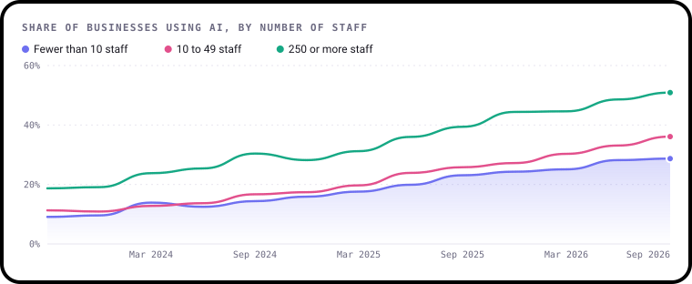
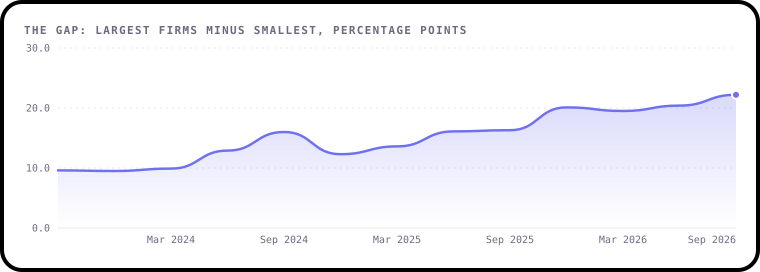

# January 2027: The small-business gap

**The question:** Why are the smallest businesses so much less likely to use AI than the biggest, and is the gap
closing?

**Runs:** 1 to 31 January 2027
**Data:** ONS Business Insights and Conditions Survey, wave 165 (21 September to 4 October 2026). It's already in
this repo.

---

## The story so far

Most UK businesses are tiny. Firms with fewer than 10 staff make up the vast majority, so whatever they do sets
the national picture. And when it comes to AI, they're behind.

In September 2023, **9.1%** of businesses with fewer than 10 staff used any kind of AI. Among firms with 250 or
more staff it was **18.7%**, about twice as many. Three years later, both have grown fast: **28.7%** of the
smallest firms use AI, and **50.9%** of the largest.



So is the gap closing? That's the puzzle, because the answer depends on how you measure it.

- **In proportion, it has narrowed a little.** Big firms were about 2 times as likely to use AI as the smallest in
  2023. Now it's about 1.8 times.
- **In percentage points, it has more than doubled**, from 9.6 points to **22.2 points**.



Which is the right way to look at it? Both tell you something real. Your job is to dig in, decide what you think
and explain why.

A clue to get you started: when ONS asks what's holding businesses back, only 7.8% of the largest firms say they
haven't tried AI. Among the smallest it's **22.3%**. Small firms are also less likely to name barriers like
cost or skills. Is that because they've found AI easy, or because they haven't got far enough to hit them?

*Both charts are made from this repo's data by [`make_charts.py`](make_charts.py), with
[bezel-charts](https://pypi.org/project/bezel-charts/), an open-source Python library created by Shaz Moghaddam,
who runs this challenge.*

---

## Get the data

It's already in this repo, so you don't need to download anything. Every file has one row per survey wave and
group, where a group is all businesses, one industry or one size band.

**[`data/ai_use.csv`](../../data/ai_use.csv)**: who uses AI, and which kinds.
**[`data/ai_barriers.csv`](../../data/ai_barriers.csv)**: what's held businesses back.

Want the very latest numbers, or to check where they came from? Run `python data/fetch.py`, which downloads
everything from the ONS website. [`data/sources.json`](../../data/sources.json) says exactly where every file
came from and who was asked each question.

**The columns you'll need this month**

| Column | In plain English |
|---|---|
| `date` | The month the survey ran, e.g. `2026-09`. The exact dates are in `period` |
| `wave` | The survey round. AI questions come every sixth wave, about once a quarter |
| `group_type` | `all`, `industry` or `size` |
| `group` | Which group the row is about. Size bands are `0 to 9`, `10 to 49`, `50 to 99`, `100 to 249` and `250 or more` staff |
| `using_ai` | In `ai_use.csv`: the share of businesses using at least one AI technology (%) |
| `text_generation_llm` | Share using AI to write text, like ChatGPT (%) |
| `not_attempted` | In `ai_barriers.csv`: share that said they haven't tried to use AI (%) |
| `cost`, `lack_of_expertise`, `no_clear_use` | Share held back by cost, a lack of AI skills, or not seeing a use for it (%) |

Every figure is a percentage of businesses. A blank means ONS hid the figure because too few businesses gave
that answer, or the question didn't offer it that wave.

---

## Pick your level

### 🟢 Beginner
Pick one size of business.
- Chart its AI use over time
- Find the wave where it grew fastest
- In one or two sentences: how much has it changed since 2023?

### 🟡 Intermediate
Pick one question:
- Chart the gap between the smallest and largest firms both ways, as a ratio and in points. Which tells the
  fairer story, and why?
- Which size band has grown fastest since 2023? Is it the one you'd expect?
- Compare the barriers small and large firms report. Which barriers grow with size, and which don't?
- Small firms make up most businesses. How close is the UK figure to the 0 to 9 staff figure, and why?

### 🔴 Expert
Bring in one more piece of data and test an idea. For example:
- **Industry mix.** Small firms are more common in some industries than others. Use the industry figures in
  `ai_use.csv` to ask whether the size gap is really an industry gap in disguise.
- **Free tools.** [`ai_adoption_route.csv`](../../data/ai_adoption_route.csv) shows how businesses got their AI.
  Have free tools helped small firms catch up?
- **Skills.** The [Department for Education's Employer Skills Survey](https://www.gov.uk/government/collections/employer-skills-survey)
  covers digital skills by business size. Does a skills gap line up with the AI gap?

Explain what you find in plain language. A clear finding beats a complicated model, and saying what your data
can't prove is a strength, not a weakness.

---

## Starter code

A small Python script, [`starter.py`](starter.py), gets you going. From the top of the repo, in Terminal on a Mac:

```bash
pip3 install -r requirements.txt
python3 challenges/2027-01-the-small-business-gap/starter.py
```

It prints a quick summary and saves two charts as SVG files, which open in any browser:

```
Share of businesses using AI, Sep 2023 to Sep 2026
Fewer than 10 staff:  9.1% then, 28.7% now
250 or more staff:    18.7% then, 50.9% now
Gap in points:        9.6 then, 22.2 now
Saved small-firms.svg and sizes-now.svg. Open them in your browser.
```

The charts are drawn with [bezel-charts](https://pypi.org/project/bezel-charts/), but use whatever you like:
matplotlib, Excel, Tableau or pen and paper all work.

---

## Share your work

Put your work in `submissions/2027-01/your-github-username/` with a `README.md` based on the
[submission template](../../SUBMISSION_TEMPLATE.md), then open a pull request. [CONTRIBUTING.md](../../CONTRIBUTING.md)
has step-by-step help.

Credit the data like this:

> Source: Office for National Statistics licensed under the Open Government Licence v3.0.

---

Created by **Shaz Moghaddam** · London
[Website](https://shazmoghaddam.github.io) · [LinkedIn](https://www.linkedin.com/in/shazmoghaddam)
