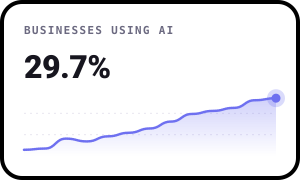
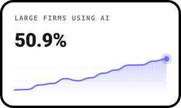
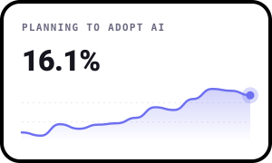
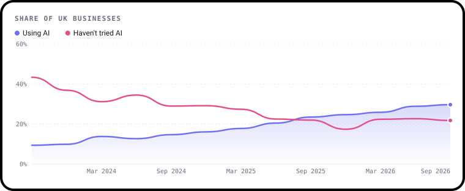
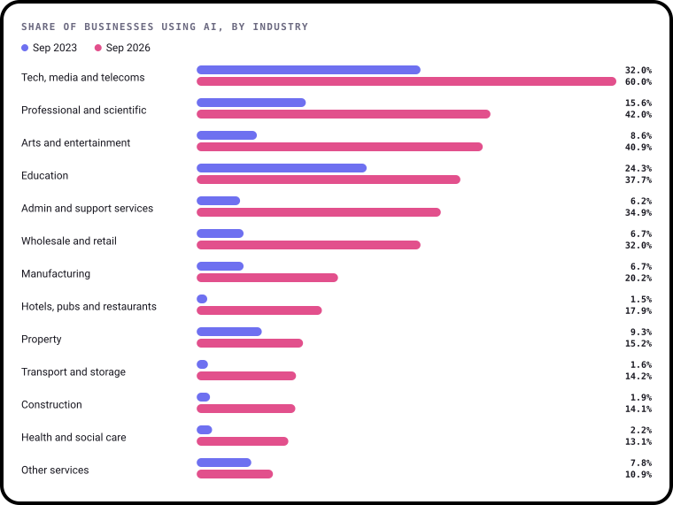
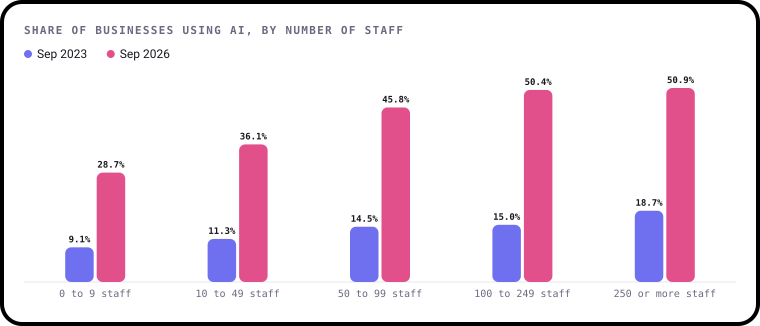
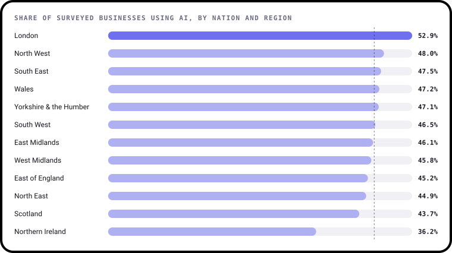
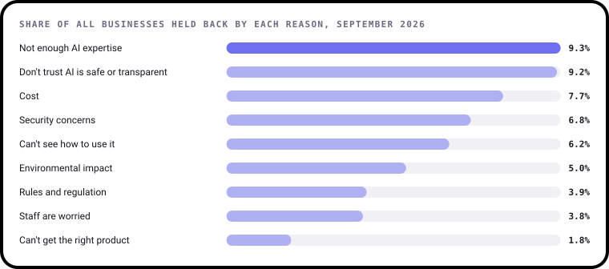

# State of AI in UK business

**Latest data: September 2026.** Every number and chart on this page is worked out from ONS data by
[`build.py`](build.py), and redrawn automatically when ONS publishes new figures. Charts are drawn with [bezel-charts](https://pypi.org/project/bezel-charts/), an open-source Python library created by Shaz Moghaddam, the author of this project.

Data from the ONS Business Insights and Conditions Survey, wave 165, released 8 October 2026.
Last downloaded: 2026-11-02 09:28 UTC.

## The headline numbers

  
  
  

Each tile shows every survey since Sep 2023. The big number is the latest figure.

- **29.7%** of UK businesses use at least one AI technology, up 6.2 points on a year earlier.
- Among firms with **250 or more staff**, it's **50.9%**, up from 18.7% in Sep 2023.
- **16.1%** say they plan to adopt AI in the next three months, against 8.0% in Sep 2023.
  Some already use it and plan to add more.

## 1. How fast is AI spreading?

When ONS first asked, in September 2023, **9.4%** of UK businesses used any kind of AI.
By September 2026 it was **29.7%**: 3.2 times as many in three years.

Over the same time the share of businesses that said they **hadn't even tried** AI fell from
**43.4%** to **21.8%**. In **September 2025**, for the first time, more businesses were using AI than said they hadn't even tried it.

- The most common use, by far, is writing text with large language models like ChatGPT. What businesses use now:
  - writing text with tools like ChatGPT: **19.0%**
  - creating images and video: **14.4%**
  - analysing data with machine learning: **8.5%**
  - recognising images: **5.0%**
- Writing text with AI went from 5.1% of businesses to 19.0%. Most of the growth is
  everyday tools, not robots or self-driving vans.
- **Most use is light.** Of businesses using AI, only **15.1%** say they use it extensively. **61.4%**
  use it on a limited basis.
- **Most AI is bought or free, not built.** 45.3% of AI users bought ready-made software and 41.2% use
  free tools. Only 14.7% built anything themselves.

So AI has gone mainstream in three years, but for most businesses it's a handy tool on the side, not something
the business runs on. Each wave is a survey with some sampling noise, so a small dip from one wave to the next means little. It's the trend that counts.

## 2. Which industries are using it?

The gap between industries is huge. In September 2026, **60.0%** of
tech, media and telecoms businesses used AI, against **10.9%** in
other services. The UK average was 29.7%.

- **Arts and entertainment** grew most, up 32.3 points since Sep 2023.
- Industries that barely used AI in 2023 have moved, from a very low start: hotels, pubs and restaurants (1.5% to 17.9%), transport and storage (1.6% to 14.2%), construction (1.9% to 14.1%).
- **Health and social care** stays near the bottom at 13.1%, even though it's
  one of the areas where people talk most about what AI could do. Much of the work is hands-on and closely
  regulated, which may slow things down.
- **Construction and transport** are also well below average. A lot of their work is physical, where chatbots
  and image tools are less obviously useful.

These are private businesses. BICS doesn't cover the public sector, so "education" here means private schools,
colleges and training firms, not state schools. Industry figures come from smaller samples, so they move around
more from one wave to the next.

## 3. Big firms against small firms

The bigger the business, the more likely it is to use AI. In September 2026, **50.9%** of firms with 250 or
more staff used it, against **28.7%** of the smallest firms, with fewer than 10 staff.

Is the gap closing? It depends how you measure it.

- **In proportion, yes.** Big firms were 2.1 times as likely as the smallest to use AI in
  Sep 2023. Now it's 1.8 times.
- **In points, no.** The gap has grown from 9.6 points to **22.2 points**, because big firms
  added 32.2 points while small ones added 19.6.

Most UK businesses are tiny, so the smallest firms set the national figure. That's why the UK average sits
close to the 0 to 9 staff number.

Bigger firms also report more barriers, partly because more of them are actually trying. In September 2026,
**14.4%** of the largest firms said a lack of AI expertise had held them back,
against 8.8% of the smallest. Only 7.8% of the largest
firms hadn't tried AI at all, against 22.3% of the smallest.

## 4. Where in the UK?

London is top at **52.9%**. That probably reflects what the industry figures show: London has more tech, media and professional firms than anywhere else, and those are the heaviest AI users. It's lowest in **Northern Ireland (36.2%)**. The line marks the middle region, 46.3%.

But the most striking thing is how **close** the regions are. Leaving the top and bottom aside, the other
10 are within **4.3 points** of each other. The spread between regions is 16.7 points. Between
industries it's 49.1 points, and between the smallest and largest firms 22.2 points.
**What a business does, and how big it is, matter far more than where it is.**

**Read these regional figures with care.** ONS only publishes them as a share of the businesses that answered,
without the weighting used for the UK, industry and size figures. The businesses that answer lean towards bigger
firms, and a business counts in every region it trades in, so the regional numbers run higher than the UK figure of 29.7%. They're
fine for comparing regions with each other, not for comparing with the rest of this page. These are for
September 2026 only.

## 5. What's holding businesses back?

ONS asks every business what, if anything, has stopped or delayed them adopting AI in the last three months.
The top reasons in September 2026 were **not enough AI expertise** (9.3%)
and **don't trust AI is safe or transparent** (9.2%).

The bigger story is how the answers have changed. In September 2023 the most common answer by far was
"we haven't tried": **43.4%**. Now it's **21.8%**. More businesses have had a go, and more
of them have hit something. The share naming at least one barrier went from about 11% to 21%.

Since Sep 2023, every barrier ONS has asked about the whole time has grown:

- **Security concerns**: 2.6% to **6.8%**
- **Cost**: 4.2% to **7.7%**
- **Not enough AI expertise**: 5.9% to **9.3%**
- **Staff are worried**: 1.1% to **3.8%**
- **Can't see how to use it**: 5.3% to **6.2%**

The concerns have moved from "is this for us?" towards **"can we trust it, and is it safe?"**. Not trusting AI to be safe or transparent is now mentioned more often than cost. ONS only started asking about trust in December 2025, so it can't be compared further back.

## What about jobs?

Since September 2025, ONS has asked businesses that use AI what it has done to their headcount.

- In September 2026, **53.4%** said no change, **5.5%** said they'd cut staff and
  too few added staff for ONS to publish a figure (it was 1.0% in June 2026).
- So among AI users, cuts outnumber hires. But the numbers are small. The question goes to the 36% of
  businesses that use AI or aren't sure, so about 2.0% of all UK
  businesses say AI has led them to cut staff so far.

This is one to watch. The sister project, [Jobs & the Economy](https://github.com/ShazMoghaddam/uk-jobs-economy), tracks
the wider jobs market.

---

**Source:** Office for National Statistics, Business Insights and Conditions Survey (BICS), under the
[Open Government Licence v3.0](https://www.nationalarchives.gov.uk/doc/open-government-licence/version/3/).
Details of every file are in [`data/sources.json`](../data/sources.json).
